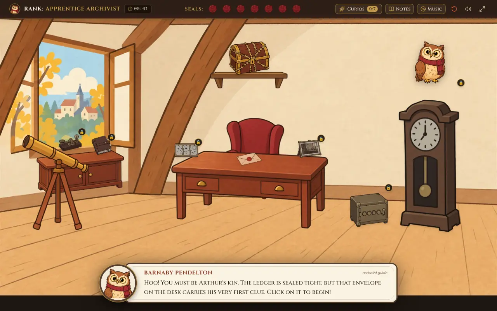
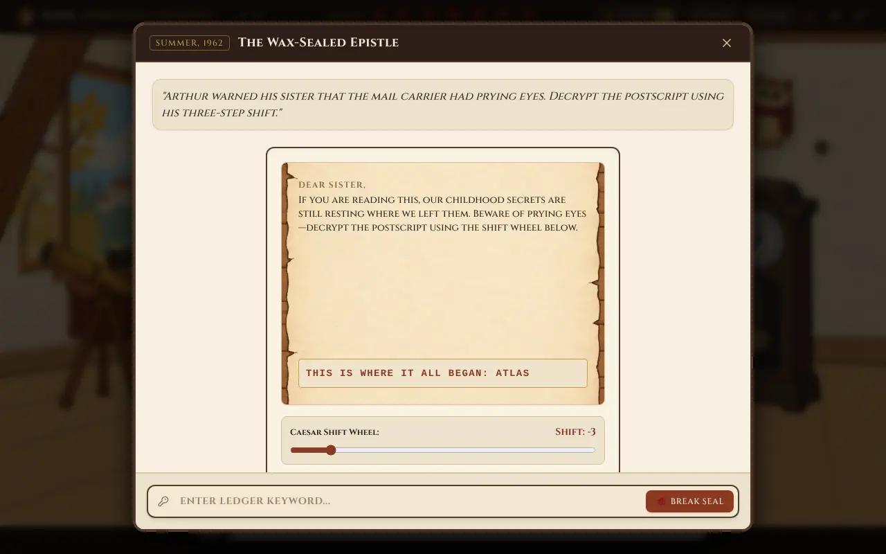
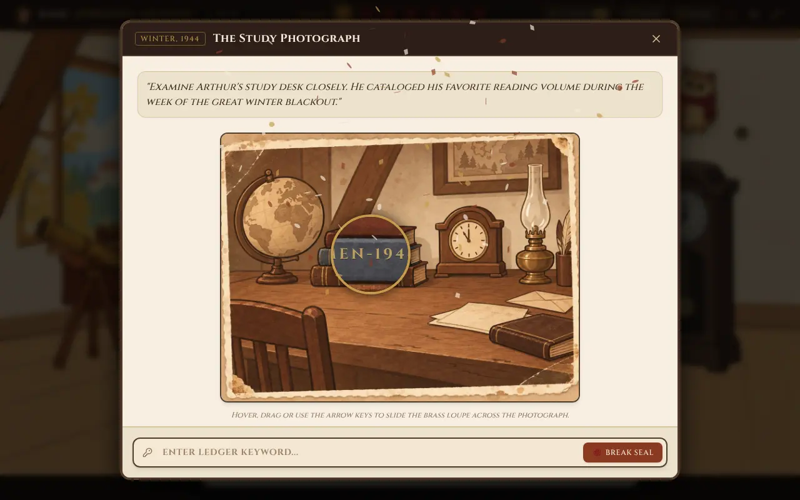
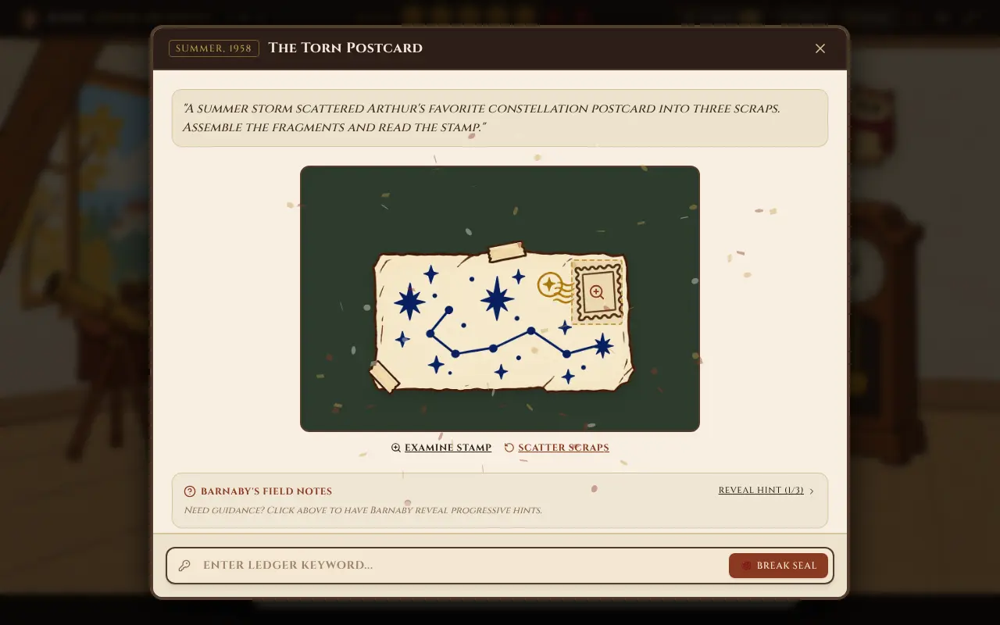
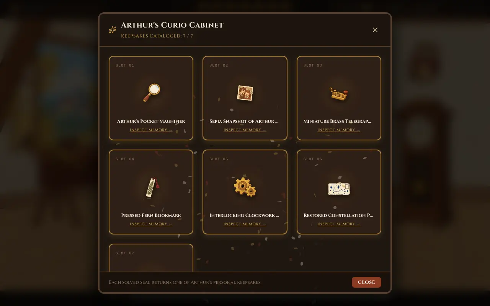
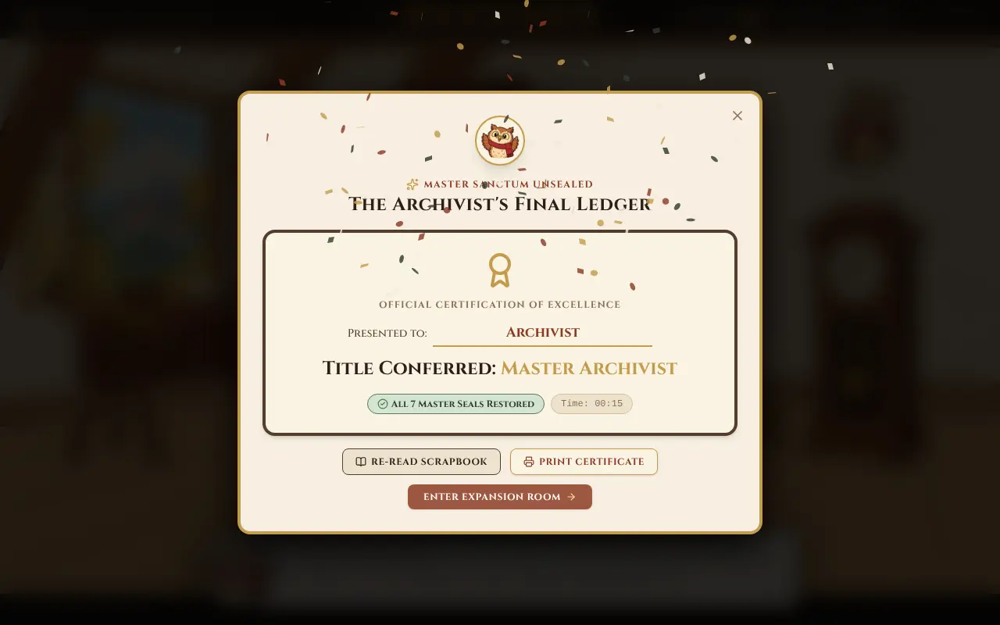
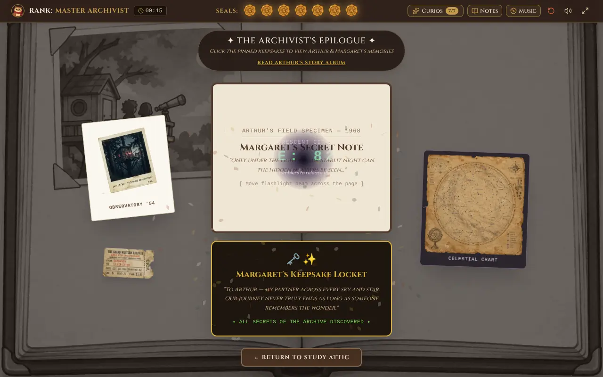

# Cryptique

a cozy little escape room you play in the browser. your uncle arthur left his attic full of locked stuff and a ledger sealed with seven wax seals. break all seven and you get into his master sanctum. barnaby the owl hangs around and gives you hints if you get stuck.

**play it here:** https://fbiopeningupp.github.io/cryptique/

> click the envelope on the desk to start. click barnaby (the owl) whenever you're stuck.

## screenshots









## how to play

- click stuff in the attic to inspect it
- locked items have a little 🔒 on them, solve earlier puzzles to open them up
- type your answer and hit **break seal**
- each puzzle has 3 hints that get more obvious, use them if you want
- **Notes** opens a notebook with a scratchpad, a caesar cipher wheel and a morse code translator
- **Curios** shows the keepsakes you've earned so far
- **Music** turns on rain, wind or a crackly record in the background
- **esc** closes whatever's open
- the red reset button wipes your save

## the puzzles

| # | puzzle | what you do |
|---|--------|-------------|
| 1 | wax-sealed letter | slide the cipher wheel to decode arthur's postscript |
| 2 | study photograph | drag a magnifying loupe over an old photo to find a book title |
| 3 | telegraph key | play the morse transmission and decode it |
| 4 | leather journal | the answer is hidden in the actual page source. inspect element works |
| 5 | clockwork safe | 4 dials, each digit comes from one of the earlier puzzles |
| 6 | torn postcard | drag the 3 torn scraps back together and read the stamp |
| 7 | pendulum clock | set the hands to when the clock stopped |

after all 7 you get into the sanctum, read arthur's scrapbook, get a certificate with your time on it (you can print it), and there's one last secret in the epilogue room with a uv flashlight.

## how it works

- all the puzzle data (answers, hints, unlock order, rewards) lives in one file, `src/data/puzzles.js`
- puzzles unlock based on prerequisites so there's a bit of branching after the first one
- every sound is made with web audio oscillators and noise buffers, there are no audio files. the morse tones, the clicks, the rain and wind, all of it
- the photo loupe renders a zoomed copy of the scene inside the lens, so the tiny book title only becomes readable when you zoom in
- the postcard scraps snap into place once you drag them close enough
- progress, timer, notes and music settings all save to localStorage so you can close the tab and come back
- the logic stuff (caesar shift, morse timing, safe dials, jigsaw snapping) is plain js with tests

## running it locally

```
npm install
npm run dev
```

then open http://localhost:5173

```
npm test        # runs the tests
npm run build   # production build in dist/
```

pushing to `main` deploys to github pages through `.github/workflows/deploy.yml`.

## built with

- react + vite
- tailwind
- framer motion
- web audio api
- canvas-confetti

## made by

[@FBIopeningUPP](https://github.com/FBIopeningUPP) and [@Poorvi230](https://github.com/Poorvi230)

## ai usage

used ai to help fix bugs and clean things up at the end.
